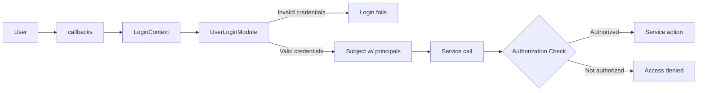

# Project Purpose
This project is a prototype Java system that uses an implementation of JAAS to handle authenticating and authorizing users. There are two types of users in the system, with separate authorization levels. Admin users have full authorization, including the ability to to register new users and edit existing users. Default users (as well as admin users) have the ability to view a list of the usernames of all users in the system. 

To accomplish this, our implementation uses LoginContext, LoginModule, Subject, callbacks, and principles from JAAS. 
- LoginContext: Coordinates the login process for all users. LoginContext is created with the database of users and callback handler and invokes the configured Login module. The Subject, representing an authenticated user, is returned after a successful login. 
- LoginModule: Performs user authentication. User credentials are requested through the configured callbacks then checked against the configured user database. On a successful login, the Subject is updated with user and role principals applicable to that user. 
- Subject: A representation of an authenticated user during a specific session. The Subject holds the applicable user and role principal. As app services are called, the app checks the subject's role before allowing any called service to run. 
- Callbacks: Allow the login module to request user information without directly having to take in the inputs. A username is requested using NameCallback, a password with PasswordCallback, and menu or role selections with ChoiceCallback. These callbacks were all implemented in the ConsoleCallbackHandler component. 
- Principals: Store defined user roles. 

# Design Overview
This project's JAAS implementation was done through these key components: 

- Main: Concrete configuration of JAAS login components. Handles service calls made by the user, and utilizes JAAS to check Subject roles before running any service actions when called. 
- UserLoginModule: Checks the user's entered credentials, and on a successful login adds user and role principals to the authenticated Subject of the current session. This Subject is then checked when authorizing service requests made by an authenticated user. 
- ConsoleCallBackHandler: Specifies the callbacks needed to collect user credentials (username, password). Also includes the callback needed for role selection when creating a new user, as well as selecting a service. 
- UnsafeUserDatabase: A prototype database that stores user account information in a largely unprotected local JSON file for a lightweight implementation. 

## Authentication & Authorization Flow Diagram

# Authentication Process
On application startup, the user database is loaded from user.json. If no such database is found, the user is prompted to create the application's initial account. This account is automatically assigned the ADMIN role, as the first user, and saved to the newly created database. 

Next, the application creates and configures a JAAS LoginContext module to use its login modeule and the newly created user database (currently with only the initial ADMIN user). During a login, the LoginContext module requests a username and password using JAAS callbacks. The console callback reads the username and password entered by the user. These credentials are checked by the login module against stored user records. If no matching credentials are found, login fails and the user is not allowed to proceed to the service selection menu. 

On a user's successful authentication, the login module adds a user principal and role principal (defining the user's authorization) to the JAAS Subject of the current session. This Subject is used by the application any time services are invoked, with authorozation checks based on the authenticated user's role to ensure that the user has the proper role to invoke the relevant service. 

# Authorization Process
Each URL accessible service implemented in the application has a role requirement specifying which roles may access it: 
- /users: Requires the DEFAULT role (accessible to both DEFAULT and ADMIN users)
- /register: Requires the ADMIN role (accessible only to ADMIN users)
- /edit-user: Requires the ADMIN role (accessible only to ADMIN users) 

Before allowing any service action to run, the main application invokes it using the authenticated Subject. The Subject's role principals are checked ahainst the required role for the invoked service to ensure that the authenticated user has authorization to run the selected service. A DEFAULT user is not authorized to register or edit accounts, while an ADMIN user has access to all 3 services, including the /users service available to DEFAULT users. If the Subject does not meet the required role, they are denied access by the application, andthe selected service action is not run. 

# Account and Role Management
When the application is started, the first account created for a new database is given the ADMIN role by default. ADMIN users are authroized to register additional user accounts through the /register service. While creating new user accounts, ADMINs are able to select whether each new account has the DEFAULT or ADMIN role. 

For new or updated accounts, any blank usernames or passwords are automatically rejected. Duplicate usernames are also rejected by the system, to keep all users uniquely identifiable. ADMIN users are authorized to change usernames or passwords of any users through the /edit-user service. When editing, a blank username or password leaves the respective field unchanged, updating only the field that was explicitly filled out. When editing an account, the predefined role for an edited user is preserved. 